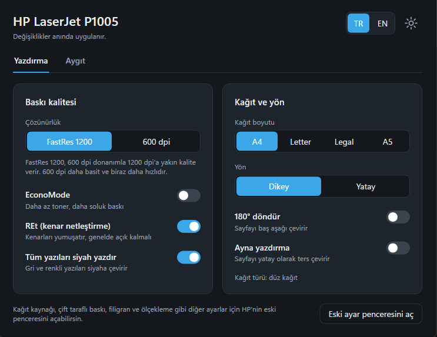
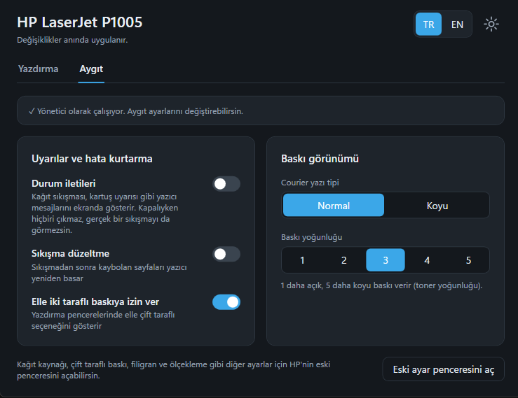
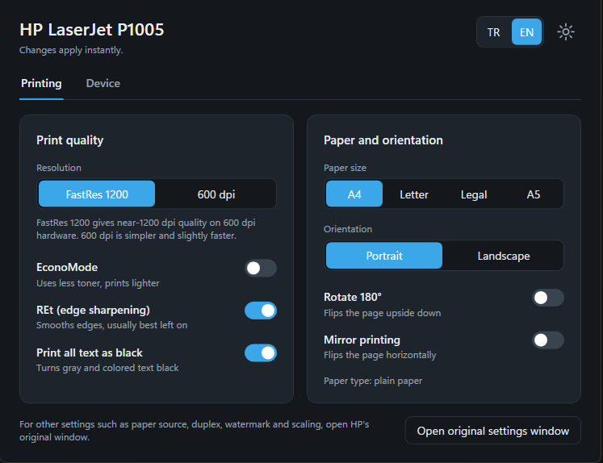
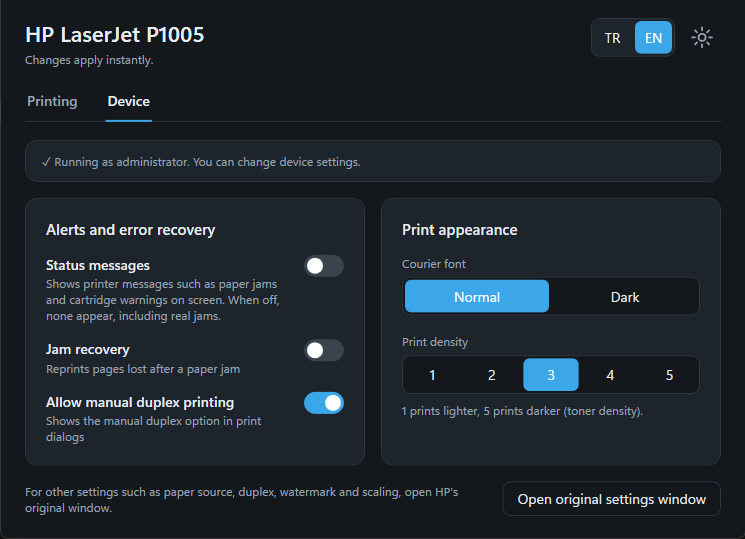

# HP LaserJet P1005 Settings

A small, modern settings app for the **HP LaserJet P1005** (and similar legacy HP/Marvell-driver printers) on Windows 10/11.
It replaces the old *Printing Preferences* and *Printer Properties → Device Settings* dialogs with one clean window
that has plain-language explanations, light/dark mode and Turkish/English UI.

**Typical uses:** turn on **EconoMode**, switch **A4/Letter**, flip **status messages** off to stop the
repeating *non-HP / third-party cartridge* pop-ups, change **print density**, and more, without digging through Control Panel.

[Türkçe açıklama aşağıda / Turkish below](#türkçe)

## Ekran görüntüleri / Screenshots

**Yazdırma sekmesi:** çözünürlük, EconoMode, kağıt boyutu ve yön ayarları tek ekranda. 
**Printing tab:** resolution, EconoMode, paper size and orientation on one screen.

**Aygıt sekmesi:** durum iletileri, sıkışma düzeltme ve baskı yoğunluğu gibi yazıcı ayarları. 
**Device tab:** printer settings such as status messages, jam recovery and print density.

**İngilizce arayüz, Yazdırma sekmesi:** sağ üstteki TR | EN seçicisiyle dil değiştirilir. 
**English interface, Printing tab:** switch the language with the TR | EN selector at the top right.

**İngilizce arayüz, Aygıt sekmesi:** durum iletileri, sıkışma düzeltme ve baskı yoğunluğu İngilizce olarak. 
**English interface, Device tab:** status messages, jam recovery and print density in English.

## Features

| Tab | Setting | What it does |
|---|---|---|
| Printing | Resolution (FastRes 1200 / 600 dpi) | Print quality mode |
| Printing | EconoMode | Saves toner, lighter print |
| Printing | REt | Edge smoothing |
| Printing | Print all text as black | Turns gray/colored text black |
| Printing | Paper size, orientation, rotate 180°, mirror | Layout |
| Device | Status messages | Printer pop-ups (jam, cartridge warnings) on/off |
| Device | Jam recovery, manual duplex, Courier dark, print density 1–5 | Printer behavior |

Other settings (paper source, duplex, watermark, scaling) are still available through a button that opens HP's original window.

## Requirements

- Windows 10 or 11
- An installed printer that uses the **HP LaserJet P1005** driver. Its name does not matter: a second
  install such as *HP LaserJet P1005 (Copy 1)* is found too, and with more than one you pick which to set.
- The 2013 HP driver (version 1.0.2.2680). The app checks the driver's settings layout before writing;
  with any other version the *Printing* tab is shown read-only rather than risk writing to the wrong place.

## Install

1. Download one of the two files from the latest **Releases** page:
   - `HP-P1005-Settings.exe` (~6 MB) needs the [.NET 8 Desktop Runtime](https://dotnet.microsoft.com/download/dotnet/8.0).
   - `HP-P1005-Settings-standalone.exe` (~75 MB) runs as it is, nothing else to install.
2. Run it. Changes on the *Printing* tab need no special rights.
3. The *Device* tab writes machine-wide printer settings and needs **administrator rights**.
   If the app is not elevated it shows a *Restart as administrator* button.

## Backup and restore

The first time the app changes a setting on a printer, it saves that printer's settings as they were
to `%LOCALAPPDATA%\YaziciKesif\` and never overwrites that copy. **Restore original settings** at the
bottom puts them back; the *Device* settings need the app to run as administrator for that.

## How it works

The old driver stores its settings in two places, and this app reads and writes them directly:

- Per-user print defaults: `HKCU\Printers\DevModePerUser` (a binary DEVMODE block; the HP-specific flags live in its driver-private part)
- Machine-wide device settings: `HKLM\SYSTEM\CurrentControlSet\Control\Print\Printers\<printer name>\PrinterDriverData`

The byte offsets were found by changing one option at a time in the original dialogs and comparing snapshots.
The byte logic lives in `P1005DevMode.cs` and is unit-tested against a real settings block (`YaziciKesif.Tests`).
Language and theme choices are remembered under `HKCU\Software\YaziciKesif`.

## Known limitations

- Only tested on the HP LaserJet P1005 with the 2013 driver.
- Paper type and paper source are not exposed yet (paper type can be reset to plain paper).

## Disclaimer

This project is **not affiliated with or endorsed by HP Inc.** "HP" and "LaserJet" are trademarks of their owners.
The app edits printer settings in the Windows registry. Use at your own risk; the settings it changes are the same ones the original dialogs change.

## Build from source

Open `YaziciKesif.sln` in Visual Studio 2022 (".NET desktop development" workload), target .NET 8, and run.
Run the tests with `dotnet test YaziciKesif.Tests`.

Releases are built by GitHub Actions (`.github/workflows/build.yml`): every push is built and tested, and
pushing a tag such as `v0.1.0` publishes both `.exe` files to a Release for that tag.

## Contributing

Issues and pull requests are welcome. Reports for other models are especially useful:
open an issue with your printer model and driver version.

## License

[MIT](LICENSE)

---

## Türkçe

**HP LaserJet P1005** (ve benzeri eski HP sürücülü yazıcılar) için Windows 10/11 üzerinde çalışan, sade ve modern bir ayar uygulaması.
Eski *Yazdırma Tercihleri* ve *Yazıcı Özellikleri → Aygıt Ayarları* pencerelerinin yerine, açıklamalı, açık/koyu temalı ve Türkçe/İngilizce arayüzlü tek bir pencere sunar.

**Sık kullanım:** **EconoMode** açma, **A4/Letter** seçme, tekrar eden **muadil kartuş uyarılarını** durdurmak için **durum iletilerini** kapatma, **baskı yoğunluğunu** ayarlama.

### Gereksinimler

- Windows 10 veya 11
- **HP LaserJet P1005** sürücüsünü kullanan kurulu bir yazıcı. Adı önemli değil: *HP LaserJet P1005 (Kopya 1)* gibi
  ikinci bir kurulum da bulunur, birden fazlaysa hangisinin ayarlanacağını seçersin.
- 2013 tarihli HP sürücüsü (1.0.2.2680). Uygulama yazmadan önce sürücünün ayar yapısını kontrol eder; başka bir
  sürümde yanlış yere yazmamak için *Yazdırma* sekmesi yalnızca görüntülenir.

### Kurulum

1. En son **Releases** sayfasından iki dosyadan birini indir:
   - `HP-P1005-Settings.exe` (~6 MB): [.NET 8 Desktop Runtime](https://dotnet.microsoft.com/download/dotnet/8.0) ister.
   - `HP-P1005-Settings-standalone.exe` (~75 MB): hiçbir şey kurmadan çalışır.
2. Çalıştır. *Yazdırma* sekmesi özel yetki gerektirmez.
3. *Aygıt* sekmesi makine geneli ayar yazdığı için **yönetici yetkisi** ister. Yetki yoksa uygulama "Yönetici olarak yeniden başlat" düğmesi gösterir.

### Yedek ve geri dönme

Uygulama bir yazıcıda ilk kez bir ayarı değiştirmeden hemen önce o yazıcının ayarlarını `%LOCALAPPDATA%\YaziciKesif\`
klasörüne kaydeder ve bu kopyanın üzerine bir daha yazmaz. Alttaki **İlk ayarlara geri dön** düğmesi onları geri yükler;
*Aygıt* ayarları için uygulamanın yönetici olarak çalışması gerekir. Dil ve tema seçimin de hatırlanır.

### Uyarı

Bu proje HP Inc. ile bağlantılı değildir. Uygulama kayıt defterindeki yazıcı ayarlarını değiştirir, kullanım sorumluluğu sana aittir. Değiştirdiği ayarlar, orijinal pencerelerin değiştirdiği ayarlarla aynıdır.
